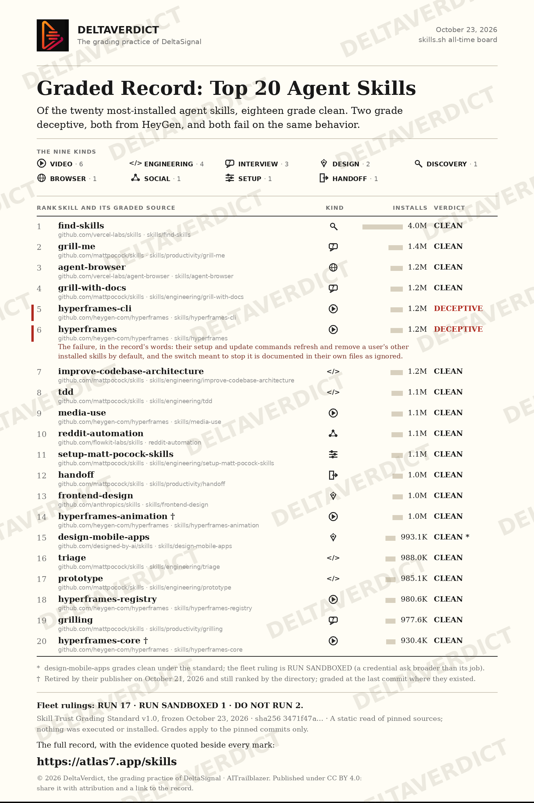

  

<h1 align="center">Graded Record: Top 20 Agent Skills</h1>

  A <strong>DeltaVerdict</strong> record, published by <strong>DeltaSignal</strong> (AITrailblazer). 
  The published page: <a href="https://atlas7.app/skills">atlas7.app/skills</a>

  
  
  

## What this is

A skill is a small pack of instructions a person installs into their AI assistant to teach it a new job: browse the web, design a page, run a test. Skills run with the assistant's own permissions, so a bad one can do real damage quietly. The most popular skills have been installed millions of times, on trust. This record is the check.

The 20 most-installed skills on [skills.sh](https://skills.sh) (all-time board, read October 23, 2026) were graded against one fixed standard, the **Skill Trust Grading Standard v1.0**, written down and frozen before grading began. The grading asked three plain questions of every skill: does it do what its description says, does it ask only for the access its job needs, and does it name everything it sends out.

## Key findings

- **18 of 20 skills graded CLEAN.**
- **2 graded DECEPTIVE, both from one publisher (HeyGen):** `hyperframes-cli` and `hyperframes`. Their setup and update commands refresh and remove the agent's other installed skills by default, and the flag meant to skip that step is documented in their own files as temporarily ignored. Fleet ruling for both: **DO NOT RUN**.
- **1 skill runs sandboxed:** `design-mobile-apps` (a credential ask broader than its job, kept under watch rather than banned).
- **The directory ranks what it no longer serves:** two of the twenty (`hyperframes-animation`, `hyperframes-core`) no longer exist in their publisher's repository. They were graded at the last commit where they existed.

## Results

| Rank | Skill | Publisher | Category | Installs | D1 | D2 | D3 | D4 | D5 | D6 | Verdict | Fleet ruling |
|---:|---|---|---|---|---:|---|---|---|---|---|---|---|---|
| 1 | [find-skills](https://github.com/vercel-labs/skills/tree/a80e4c9d12d607631249d4d7d059f835d4b2f13a/skills/find-skills) | vercel-labs | Discovery | 4.0M | PASS | PASS | PASS | PASS | PASS | PASS | CLEAN | RUN |
| 2 | [grill-me](https://github.com/mattpocock/skills/tree/5beb35b040e3de97e54fa9e386d7e42d15c295c2/skills/productivity/grill-me) | mattpocock | Interview | 1.4M | PASS | PASS | PASS | PASS | PASS | PASS | CLEAN | RUN |
| 3 | [agent-browser](https://github.com/vercel-labs/agent-browser/tree/372ac5ce20fab885dbf45ee0c9d510ec8c3b6fdb/skills/agent-browser) | vercel-labs | Browser | 1.2M | PASS | PASS | PASS | PASS | FLAG | PASS | CLEAN | RUN |
| 4 | [grill-with-docs](https://github.com/mattpocock/skills/tree/5beb35b040e3de97e54fa9e386d7e42d15c295c2/skills/engineering/grill-with-docs) | mattpocock | Interview | 1.2M | PASS | PASS | PASS | PASS | PASS | PASS | CLEAN | RUN |
| 5 | [hyperframes-cli](https://github.com/heygen-com/hyperframes/tree/6ad7c82d2175d018a93a85e96883dc31231b9884/skills/hyperframes-cli) | heygen-com | Video | 1.2M | PASS | FLAG | PASS | PASS | FAIL | PASS | DECEPTIVE | DO NOT RUN |
| 6 | [hyperframes](https://github.com/heygen-com/hyperframes/tree/6ad7c82d2175d018a93a85e96883dc31231b9884/skills/hyperframes) | heygen-com | Video | 1.2M | PASS | FLAG | FLAG | FLAG | FAIL | PASS | DECEPTIVE | DO NOT RUN |
| 7 | [improve-codebase-architecture](https://github.com/mattpocock/skills/tree/5beb35b040e3de97e54fa9e386d7e42d15c295c2/skills/engineering/improve-codebase-architecture) | mattpocock | Engineering | 1.2M | PASS | PASS | PASS | PASS | PASS | PASS | CLEAN | RUN |
| 8 | [tdd](https://github.com/mattpocock/skills/tree/5beb35b040e3de97e54fa9e386d7e42d15c295c2/skills/engineering/tdd) | mattpocock | Engineering | 1.1M | PASS | PASS | PASS | PASS | PASS | PASS | CLEAN | RUN |
| 9 | [media-use](https://github.com/heygen-com/hyperframes/tree/6ad7c82d2175d018a93a85e96883dc31231b9884/skills/media-use) | heygen-com | Video | 1.1M | PASS | PASS | PASS | PASS | PASS | PASS | CLEAN | RUN |
| 10 | [reddit-automation](https://github.com/flowkit-labs/skills/tree/0c9e2b63f504a296a86e45ed3a60a426dd979ca6/reddit-automation) | flowkit-labs | Social | 1.1M | PASS | PASS | PASS | PASS | FLAG | PASS | CLEAN | RUN |
| 11 | [setup-matt-pocock-skills](https://github.com/mattpocock/skills/tree/5beb35b040e3de97e54fa9e386d7e42d15c295c2/skills/engineering/setup-matt-pocock-skills) | mattpocock | Setup | 1.1M | PASS | PASS | PASS | PASS | PASS | PASS | CLEAN | RUN |
| 12 | [handoff](https://github.com/mattpocock/skills/tree/5beb35b040e3de97e54fa9e386d7e42d15c295c2/skills/productivity/handoff) | mattpocock | Handoff | 1.0M | PASS | PASS | PASS | PASS | PASS | PASS | CLEAN | RUN |
| 13 | [frontend-design](https://github.com/anthropics/skills/tree/dbd4588f9e1033efb41dad4bef2f7947c8993d44/skills/frontend-design) | anthropics | Design | 1.0M | PASS | PASS | PASS | PASS | PASS | PASS | CLEAN | RUN |
| 14 | [hyperframes-animation](https://github.com/heygen-com/hyperframes/tree/207c8a4daf6480d697f203784f1fd422727569e3/skills/hyperframes-animation) | heygen-com | Video | 1.0M | PASS | PASS | PASS | PASS | PASS | PASS | CLEAN | RUN |
| 15 | [design-mobile-apps](https://github.com/designed-by-ai/skills/tree/03c20aec6dcedb5fabfb03dc37982eb52ef19ed6/skills/design-mobile-apps) | designed-by-ai | Design | 993.1K | PASS | PASS | FLAG | PASS | PASS | PASS | CLEAN | RUN SANDBOXED |
| 16 | [triage](https://github.com/mattpocock/skills/tree/5beb35b040e3de97e54fa9e386d7e42d15c295c2/skills/engineering/triage) | mattpocock | Engineering | 988.0K | PASS | PASS | PASS | PASS | PASS | PASS | CLEAN | RUN |
| 17 | [prototype](https://github.com/mattpocock/skills/tree/5beb35b040e3de97e54fa9e386d7e42d15c295c2/skills/engineering/prototype) | mattpocock | Engineering | 985.1K | PASS | PASS | PASS | PASS | PASS | PASS | CLEAN | RUN |
| 18 | [hyperframes-registry](https://github.com/heygen-com/hyperframes/tree/6ad7c82d2175d018a93a85e96883dc31231b9884/skills/hyperframes-registry) | heygen-com | Video | 980.6K | PASS | PASS | PASS | PASS | PASS | PASS | CLEAN | RUN |
| 19 | [grilling](https://github.com/mattpocock/skills/tree/5beb35b040e3de97e54fa9e386d7e42d15c295c2/skills/productivity/grilling) | mattpocock | Interview | 977.6K | PASS | PASS | PASS | PASS | PASS | PASS | CLEAN | RUN |
| 20 | [hyperframes-core](https://github.com/heygen-com/hyperframes/tree/207c8a4daf6480d697f203784f1fd422727569e3/skills/hyperframes-core) | heygen-com | Video | 930.4K | PASS | PASS | PASS | PASS | PASS | PASS | CLEAN | RUN |

Skill names in this table link to the graded source folder at the pinned commit.

The six dimensions: **D1** claims vs content · **D2** permissions surface · **D3** credential asks · **D4** outbound data · **D5** instruction hygiene · **D6** provenance. Every mark in the full record carries its quoted evidence from the pinned source.

## How the grading worked

- The standard was frozen before any grading: [STANDARD.md](STANDARD.md), sha256 `3471f47a2fb8d15a0d461573753372adbe576e834ffbd1512762055b913516ba` ([FREEZE.md](FREEZE.md), [FREEZE.sha256](FREEZE.sha256)).
- Each skill was graded at a pinned commit of its publisher's repository ([SOURCES.md](SOURCES.md)); the corpus snapshot is [CORPUS.md](CORPUS.md).
- Two independent blind passes graded all 20 ([pass-a.md](pass-a.md), [pass-b.md](pass-b.md)). The passes differed on 10 of 120 marks; every difference was settled by a third read of the pinned source, with the settling quotes printed in [FINAL-GRADES.md](FINAL-GRADES.md).
- One pass proposed an interpretive exception to the hygiene rule. It was rejected: the frozen standard's text governs, and the ruling is printed in the final grades.

## What this is not

- Not a test of whether a skill does its job well. Nothing in the corpus was executed or installed; the grading is a static read of the source folders.
- Not a malware scan. A clean grade means the skill's stated behavior, access asks, and disclosures match its contents under the standard. It is not a guarantee about code that was never run.

## The record

- Published page: https://atlas7.app/skills
- Full grades with quoted evidence: [FINAL-GRADES.md](FINAL-GRADES.md)
- The standard: [STANDARD.md](STANDARD.md)
- Corpus and pins: [CORPUS.md](CORPUS.md), [SOURCES.md](SOURCES.md)

Grades apply to the pinned commits only. A later version of any skill is a new object and would be graded on its own record.

## Cite this record

DeltaVerdict (2026). *Graded Record: Top 20 Agent Skills.* Skill Trust Grading Standard v1.0, frozen 2026-10-23 (sha256 `3471f47a2fb8d15a0d461573753372adbe576e834ffbd1512762055b913516ba`). Published page: https://atlas7.app/skills · Evidence: https://github.com/aitrailblazer/skills-record

---

   
  DeltaVerdict is the grading practice of <a href="https://deltasignal.substack.com">DeltaSignal</a> · AITrailblazer

